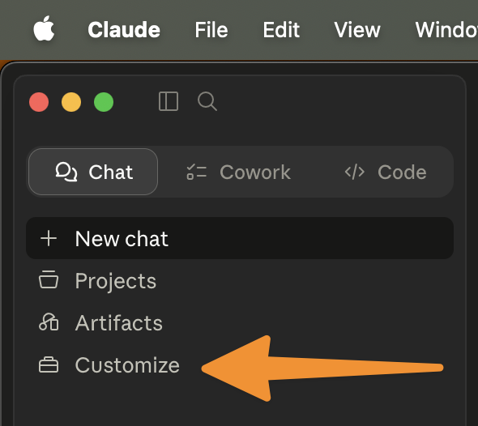
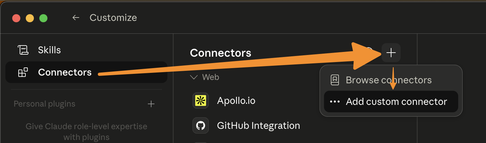
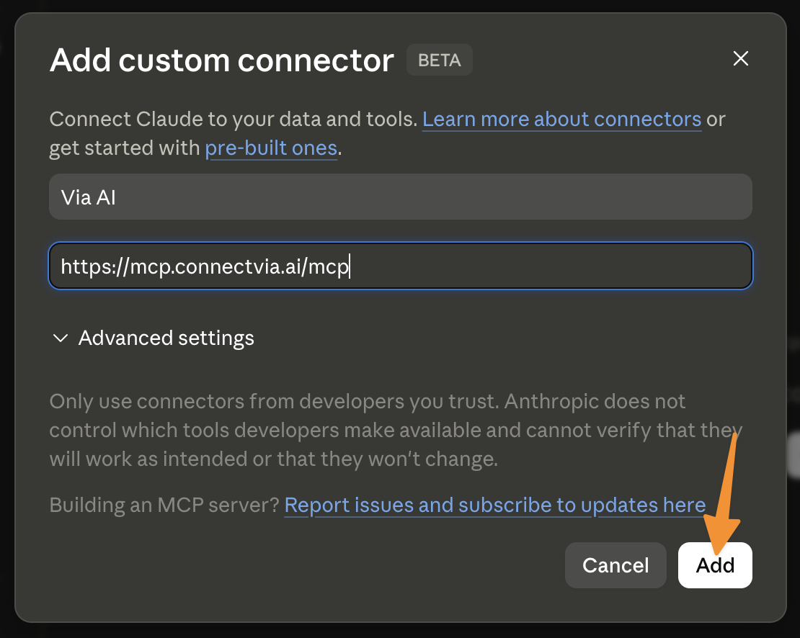

<!-- Generated from Via's internal docs. Edits made in this public repo are overwritten on the next sync. -->

# Via AI MCP Server

Via AI's MCP server gives AI assistants read-only access to your professional network --
finding people and companies, and showing how well-connected you are to each one, through
natural conversation. It also exposes explicit workspace actions for lists, networks,
follows, research settings, result views and exports. Some actions delete or replace data;
Via enforces the applicable confirmation requirements. The connector does not send outreach.

## Features

- **People search**: Find people by name, persona, role, title, function, seniority, or
  location, or look up one exact person by email or LinkedIn profile URL.
  Bounded name matching tolerates middle names and initials while preserving
  uncertainty; identity matches and qualifying relationships in the selected
  network are reported separately. Employer-qualified names use the complete
  bounded global name cohort, not a reachable namesake or a rank winner.
  Employer-qualified names need matching canonical employer IDs or the full
  authored phrase in the person's employer name. Independently resolved labels,
  aliases, or domain stems cannot drop authored qualifiers. Similar spellings
  alone do not establish the same employer, even when employer details are
  incomplete.
  Role-qualified exact names preserve the complete qualifying identity cohort
  before checking selected-network relationships. Name-picker pages return the
  requested window without treating its size as proof of unique identity.
  Both exact lookups and search pages include current employment details,
  including job titles, when available.
- **Company search**: Look up companies by name or domain, with employee count, industries,
  and domains. Find companies through connections whose current title contains requested
  text and whose seniority matches a requested level; the same connection must meet both
  criteria at that company.
- **Access on every row**: Every person or company result carries a compact summary of how
  well you can reach them -- no extra query required.
- **Pathways**: Select a person from a result to open the routes connecting you to them,
  with the evidence behind each one (shared work history, education, email, meetings, and
  more).
- **Relationship enrichment**: Read selected people's relationship facts as a reusable
  payload for your CRM, agent, or workflow. `read_relationship_evidence` defaults to
  `detail: "brief"`: up to three whole facts and 1 KiB of facts per relationship.
  Identities, relationship direction, evidence status, and missing coverage remain
  explicit. `factoid_count` counts returned facts; `total_factoid_count` and
  `factoids_truncated` show when more are available. Request `detail: "full"` for
  all published facts, or use `row_ids` to select up to 200 retained people.
  Without `row_ids`, `limit` defaults to 25. Brief and full modes cover the same
  selected people. Another connected app can consume this payload; this read does
  not update your CRM or send email.
- **Insights**: Ask for a specific rollup -- your strongest connections, your best-connected
  companies, or where your network clusters by function or location.
- **Target lists**: Save a complete People or Companies result, reopen a saved list,
  and review its targets, next actions, and history. Saved lists show their latest
  recorded Access while background checks update it. Opening a list does not start
  another Access query. Saving never starts outreach.
  MCP tools use `read_target_list_workspace`, `write_target_list_workspace`,
  and `target_list_id`. Target List action names also use `target_list`.
  People and Company Lists stay separate: mixed or opposite-kind additions return
  `target_list_target_kind_mismatch` in structured error data without changing the List.
  The human reply names the destination kind, suggests a matching-kind target list,
  and says nothing was saved; internal codes stay out of the refusal text. Company Lists can
  retain unresolved source targets even when no canonical company is found.
  Resolver outages still fail without creating a List.
  Existing mixed Lists remain unchanged.
  Already-supported empty Company saves retain Company kind and their source Networks.
- **Email hand-offs**: When you hand an email you are drafting in Via to your own agent,
  Via queues a brief for it. Your agent lists your queued hand-offs, reads one brief, writes
  the email in your own mail tool, and marks the hand-off drafted or skipped. Via never
  sends the email, and these tools only see your own hand-offs.
- **Prompt suggestions**: The connector publishes starting prompts, including a guided
  walkthrough -- say `via-demo` or `via demo`, or pick "Where does my network already reach
  my buyers?" from your client's prompt suggestions. Slash-command support varies by client.
  The reviewed walkthrough ships with each server release. Both the demo resource and
  `get_demo_prompt` serve that version; neither fetches demo instructions from a website.

## Setup

### Prerequisites

- A [Via AI](https://www.connectvia.ai) account

### Claude.ai / Claude Desktop

Add Via AI as a custom connector:

1. Open Claude and click **Customize** in the left sidebar.

   

2. Select **Connectors**, click **Add**, and choose **Add custom connector**.

   

3. In the **Add custom connector** dialog, enter a name (e.g. `Via AI`) and the server URL
   `https://mcp.connectvia.ai/mcp`, then click **Continue**. On the next screen, keep the detected
   settings and click **Add**.

   

4. Follow the OAuth flow to authorize your Via AI account.

### Claude Code

```
claude mcp add --transport http via https://mcp.connectvia.ai/mcp
```

Interactive results need an MCP Apps-capable client such as Claude.ai or Claude Desktop.
Data-only clients can read result rows and request a selected person's Pathways through tools.
Responses include each result row once, with page counts that match the returned rows.
The result-row tool accepts either the returned continuation cursor or the next-page
address. Paging reads the saved result and does not repeat the query.

Or add it to your Claude Code configuration directly:

```json
{
  "mcpServers": {
    "via": {
      "type": "http",
      "url": "https://mcp.connectvia.ai/mcp"
    }
  }
}
```

### ChatGPT plugin

Configure the Via plugin with `https://mcp.connectvia.ai/mcp/openai`.
This endpoint exposes each workspace operation with its own name and typed inputs,
including Target List operations, while sharing Via's execution and confirmation rules.
The catalog below lists its operations. Claude setup and the optional Claude companion
continue to use `https://mcp.connectvia.ai/mcp`.

The operation endpoint provides a compact index of tool purposes, argument names,
and confirmation requirements during initialization. Hosts supporting native tool
search can use this index while loading full input schemas on demand. The host
controls loading; the server continues to publish the complete operation catalog.

### Compact data connections

Private server operators can enable an optional compact data profile on `/mcp`.
With Target Lists enabled, this publishes eight tools for network search, paging,
selected-person Pathways, product reads/writes, Target List workspace reads/writes,
and action-schema discovery. The original 46 product actions retain their existing
permissions and confirmations. This profile returns data and excludes interactive
Apps and supplemental identity lookups, signals, hand-offs and standalone evidence
reads. Default connections keep the full catalog.

This optional profile is for private functional testing. It is not the ChatGPT
directory catalog, which requires individually exposed operations on `/mcp/openai`.

### Authentication

Via AI uses OAuth 2.0 through WorkOS AuthKit, with standard MCP resource-server discovery.
When you first connect, you'll be redirected to Via AI's login page to authorize access.
Tokens are automatically refreshed.

### Account readiness

New accounts finish a short onboarding step (Terms acceptance and profile) at
[app.connectvia.ai](https://app.connectvia.ai). `get_authenticated_user` returns your
profile and, where enabled, your Terms and onboarding status.

## Companion skill / plugin

Via publishes an official **Network Workflow** skill that teaches the assistant to use one
typed query per request, read the Access summary already on each row, and open Pathways
only from a selected person. Ordinary requests use Via's returned data. Interactive
requests render the retained result without another query or duplicate tables.
The **Via** plugin bundles that skill with the connector for one-step setup.

Both are available once you're signed in at [app.connectvia.ai](https://app.connectvia.ai):
open the **Agent** panel, choose the **Connect** tab, and use the **Downloads** section of
the **Via for Claude** card. The plugin installs by uploading its ZIP in Claude's
**Customize -> Plugins**; the skill unzips alongside your custom connector.

The companion is optional. `get_mcp_status` reports its identity and version compatibility,
without download links or installation instructions. Downloads remain a user choice in
Via's setup card; the connector does not require a skill installation to operate.

Skill version `2026.10.14.1` and plugin version `1.0.13` use the separate read and
write tools. The companion keeps other requested sources separate from Via's results.
It reads viewer-to-person evidence in batches and verifies introduction-route legs
through selected-Person Pathways. Missing evidence remains unknown.
Earlier skill versions report `update_required`. The assistant explains the version
mismatch and asks before an update; it does not download or install one without
explicit user approval. The connector remains available without the companion.

## Tools

Every tool publishes the same readable name in `title` and `annotations.title`.
`run_network_query.network_scope` explicitly declares its object type and retains
its referenced schema for network-source and relationship constraints.

<!-- BEGIN GENERATED TOOLS (scripts/render_mcp_public_readme.py) -->

### Claude and existing MCP clients

#### Read-only queries

| Tool                            | Description                                                                                                                                                           |
| ------------------------------- | --------------------------------------------------------------------------------------------------------------------------------------------------------------------- |
| `run_network_query`             | Find People or Companies using your network and optional company columns from files stored in Via, with Access on each row and Pathways from a selected person.       |
| `search_people`                 | Look up people by name, email or LinkedIn URL with bounded canonical name matching, distinct from selected-network matches; use run_network_query for title searches. |
| `search_companies`              | Look up companies by name or domain, with employee count, industries, and domains.                                                                                    |
| `find_network_insights`         | Compute network insights including companies by persona; second degree is opt-in, and unsearched or incomplete zero counts are unknown.                               |
| `get_authenticated_user`        | Read your Via profile and your Terms/onboarding status.                                                                                                               |
| `get_demo_prompt`               | Get the guided Via walkthrough included with this server release, without fetching a web page.                                                                        |
| `get_mcp_status`                | Check that your Via connection is ready, or inspect a previous result.                                                                                                |
| `read_signals`                  | Read your Via activity feed and summary, a specific person, and your saved follows and subscriptions.                                                                 |
| `list_outreach_handoffs`        | List the email hand-offs you queued in Via for your own agent to write.                                                                                               |
| `get_outreach_handoff`          | Read one queued email hand-off with its full brief and draft details.                                                                                                 |
| `read_product_command`          | Read saved lists, networks, result summaries, and person networks through supported Via queries.                                                                      |
| `read_target_list_workspace`    | Browse your Target Lists, saved results, and their targets and activity.                                                                                              |
| `render_network_result`         | Display a completed People or Companies result.                                                                                                                       |
| `read_network_result_page`      | Read more rows from a result, or check whether it has finished computing.                                                                                             |
| `open_selected_person_pathways` | Verify introduction routes and relationship evidence for one person on a saved result.                                                                                |
| `read_relationship_evidence`    | Read brief relationship facts or full detail for selected people, including connector preview second legs with verified and missing coverage.                         |

#### Actions

These manage Via workspace data and settings, including lists, networks, follows and result views. Some actions delete or replace data and require confirmation. They do not send outreach messages.

| Tool                          | Description                                                                                              |
| ----------------------------- | -------------------------------------------------------------------------------------------------------- |
| `complete_outreach_handoff`   | Mark a queued email hand-off as drafted or skipped once your agent has handled it.                       |
| `write_product_command`       | Change lists, networks, follows, settings, result views, and target lists through supported Via actions. |
| `write_target_list_workspace` | Save a People or Companies result as a Target List without starting outreach.                            |

### ChatGPT operation catalog

#### Read-only queries

| Tool                            | Description                                                                                                                                                     |
| ------------------------------- | --------------------------------------------------------------------------------------------------------------------------------------------------------------- |
| `run_network_query`             | Find People or Companies using your network and optional company columns from files stored in Via, with Access on each row and Pathways from a selected person. |
| `search_people`                 | Resolve exact emails or LinkedIn URLs to person identities with a status for every input.                                                                       |
| `search_companies`              | Look up companies by name or domain, with employee count, industries, and domains.                                                                              |
| `find_network_insights`         | Compute network insights including companies by persona; second degree is opt-in, and unsearched or incomplete zero counts are unknown.                         |
| `get_authenticated_user`        | Read your Via profile and your Terms/onboarding status.                                                                                                         |
| `get_demo_prompt`               | Get the guided Via walkthrough included with this server release, without fetching a web page.                                                                  |
| `get_mcp_status`                | Check that your Via connection is ready, or inspect a previous result.                                                                                          |
| `read_signals`                  | Read your Via activity feed and summary, a specific person, and your saved follows and subscriptions.                                                           |
| `list_outreach_handoffs`        | List the email hand-offs you queued in Via for your own agent to write.                                                                                         |
| `get_outreach_handoff`          | Read one queued email hand-off with its full brief and draft details.                                                                                           |
| `list_readback`                 | List readback in Via.                                                                                                                                           |
| `network_readback`              | Network readback in Via.                                                                                                                                        |
| `describe_results`              | Describe results in Via.                                                                                                                                        |
| `open_person_network`           | Open person network in Via.                                                                                                                                     |
| `list_target_lists`             | List the signed-in user's accessible Via Target Lists when asked to browse them.                                                                                |
| `open_target_list`              | Read one accessible Via Target List: members and saved results by default, or its events, comments or next_actions section; contains no call transcripts.       |
| `render_network_result`         | Display a completed People or Companies result.                                                                                                                 |
| `read_network_result_page`      | Read more rows from a result, or check whether it has finished computing.                                                                                       |
| `open_selected_person_pathways` | Verify introduction routes and relationship evidence for one person on a saved result.                                                                          |
| `read_relationship_evidence`    | Read brief relationship facts or full detail for selected people, including connector preview second legs with verified and missing coverage.                   |

#### Actions

These manage Via workspace data and settings, including lists, networks, follows and result views. Some actions delete or replace data and require confirmation. They do not send outreach messages.

| Tool                         | Description                                                                                                                           |
| ---------------------------- | ------------------------------------------------------------------------------------------------------------------------------------- |
| `complete_outreach_handoff`  | Mark a queued email hand-off as drafted or skipped once your agent has handled it.                                                    |
| `create_list`                | Create list in Via.                                                                                                                   |
| `add_to_list`                | Add to list in Via.                                                                                                                   |
| `remove_from_list`           | Remove from list in Via.                                                                                                              |
| `save_selection_as_list`     | Save selection as list in Via.                                                                                                        |
| `rename_list`                | Rename list in Via.                                                                                                                   |
| `delete_list`                | Delete list in Via.                                                                                                                   |
| `create_network`             | Create network in Via.                                                                                                                |
| `add_to_network`             | Add to network in Via.                                                                                                                |
| `remove_from_network`        | Remove from network in Via.                                                                                                           |
| `move_to_network`            | Move to network in Via.                                                                                                               |
| `rename_network`             | Rename network in Via.                                                                                                                |
| `delete_network`             | Delete network in Via.                                                                                                                |
| `import_connections`         | Import connections in Via.                                                                                                            |
| `create_target_list`         | Create target list in Via.                                                                                                            |
| `rename_target_list`         | Rename target list in Via.                                                                                                            |
| `archive_target_list`        | Archive target list in Via.                                                                                                           |
| `open_person_dossier`        | Open person dossier in Via.                                                                                                           |
| `open_company_dossier`       | Open company dossier in Via.                                                                                                          |
| `save_target_list_radar`     | Save target list radar in Via.                                                                                                        |
| `add_target_list_note`       | Add target list note in Via.                                                                                                          |
| `add_target_list_member`     | Add target list member in Via.                                                                                                        |
| `remove_target_list_member`  | Remove target list member in Via.                                                                                                     |
| `export_results`             | Export results in Via.                                                                                                                |
| `remove_rows_where`          | Remove rows where in Via.                                                                                                             |
| `filter_rows`                | Filter rows in Via.                                                                                                                   |
| `sort_rows`                  | Sort rows in Via.                                                                                                                     |
| `cap_rows`                   | Cap rows in Via.                                                                                                                      |
| `undo_last`                  | Undo last in Via.                                                                                                                     |
| `pivot_view`                 | Pivot view in Via.                                                                                                                    |
| `rerank_as`                  | Rerank as in Via.                                                                                                                     |
| `follow_company`             | Follow company in Via.                                                                                                                |
| `follow_person`              | Follow person in Via.                                                                                                                 |
| `unfollow_entity`            | Unfollow entity in Via.                                                                                                               |
| `run_target_list_audit`      | Run target list audit in Via.                                                                                                         |
| `dossier_curate`             | Dossier curate in Via.                                                                                                                |
| `set_agent_icp`              | Set agent icp in Via.                                                                                                                 |
| `agent_watch_add`            | Agent watch add in Via.                                                                                                               |
| `agent_watch_remove`         | Agent watch remove in Via.                                                                                                            |
| `set_agent_cadence`          | Set agent cadence in Via.                                                                                                             |
| `watcher_pause`              | Watcher pause in Via.                                                                                                                 |
| `watcher_resume`             | Watcher resume in Via.                                                                                                                |
| `set_target_list_goal`       | Set target list goal in Via.                                                                                                          |
| `save_result_as_target_list` | Save a complete authorized People or Companies result as a Via Target List after an explicit save request, without starting outreach. |

<!-- END GENERATED TOOLS -->

For explicit second-degree or two-hop persona requests, the initiating host sends
the typed `include_second_degree=true` flag to `find_network_insights`; the default
is `false`. Use the same selected `network_scope`, preserving its sources,
exclusions, strength and evidence constraints. Only degree changes for that query,
not the saved filters or global default. Unsearched second-degree counts are
`null` with `second_degree_status="not_searched"`; partial or unavailable coverage
also withholds a misleading zero while retaining valid matches and diagnostics.
A numeric `0` with status `"searched"` means the searched sample completed without
matching second-degree contacts for that company.

## Usage Examples

### Example 1: Finding warm introductions to a target company

**User prompt:** "How am I connected to people at Stripe? I'm looking for warm
introductions."

**What happens:** Claude calls `run_network_query` once for people at Stripe and answers
from the returned rows. Each row carries an Access summary -- how well you can reach that
person today. If you ask to browse or interact with the result, Claude displays that same
saved result without repeating the search. Selecting a promising person in the interactive
view opens their Pathways: the routes connecting you to them, with the evidence behind each
one, such as shared work history or email activity.

### Example 2: Researching a prospect before outreach

**User prompt:** "Look up john.smith@acme.com and tell me how we're connected."

**What happens:** Claude calls `search_people` with `identifiers: [{"email":
"john.smith@acme.com"}]` for an exact match -- profile only, no network query. To answer
how you're connected, Claude then runs one `run_network_query` for John; select him in the
result to open his Pathways, showing the strongest route in along with its supporting
evidence.

### Example 3: Comparing target accounts

**User prompt:** "Compare Stripe and HubSpot by how well my network can reach them."

**What happens:** Claude calls `run_network_query` once with a Companies result and the
2 named targets. It answers from each company's Access summary and reports unresolved
or incomplete results separately. You can ask to display the same result or explicitly
save it as a Target List. Saving does not start outreach.

When you ask for a summary of the current result, Via counts the complete
visible view, including rows beyond its first page. The summary respects the
result's relationship-strength selection and does not run another search.

## Working with other connectors

Via supplies network results, relationship evidence and Via workspace actions. Your
assistant can combine these with separately authorized CRM, prospecting, call-recorder
or messaging connectors. Those connectors own their reads, writes and sends; connecting
Via alone does not grant access to them or to your chat history.

Paste company names or domains for a direct query. File-column references require a file
already stored in Via with an authorized attachment identifier. They cannot read arbitrary
files attached to your assistant's chat.

## Troubleshooting

- **Connection or account issue:** Ask for `get_mcp_status` and `get_authenticated_user`.
  Finish any required Terms/profile steps in Via. Reconnect the custom connector if its
  authorization has expired or you revoked it.
- **Trial ended:** A personal account whose Via trial has ended gets a tool error with
  code `personal_plan_required` and a billing link. Subscribe in Via, then retry.
- **Results still running:** Continue reading the same result. Pending or failed work does
  not mean that your network has no matches.
- **No interactive table:** Use a client with MCP Apps support, or ask for data rows.
- **Missing relationship evidence:** Request it for selected rows or open the person's
  Pathways. Deferred evidence does not arrive through repeated page reads alone.
- **Need help:** Contact support below with your client and the error message.
  Do not send access tokens or private network exports.

## Privacy Policy

[Via AI Privacy Policy](https://www.connectvia.ai/privacy)

## Support

- **Email:** help@connectvia.ai
- **Website:** [connectvia.ai](https://www.connectvia.ai)
